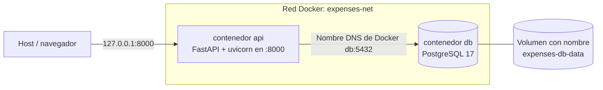
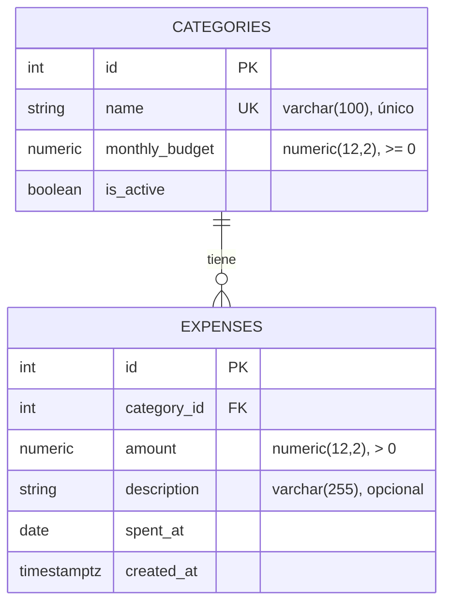

# personal-expenses-ci

[](https://github.com/Ander0907/personal-expenses-ci/actions/workflows/ci.yml)

Una pequeña API de gastos personales (categorías, gastos y un reporte mensual) construida con FastAPI y PostgreSQL. La aplicación es solo el vehículo para la entrega del curso "Docker con dos contenedores comunicados" (Integración Continua): el foco está en la configuración de Docker (un contenedor de API y un contenedor de PostgreSQL conectados con Docker Compose) y en el pipeline de GitHub Actions que construye la imagen y prueba el stack en ejecución en cada push y pull request.

## Arquitectura



- El servicio `api` llega a la base de datos mediante el nombre del servicio de Compose (`DATABASE_HOST=db`), nunca `localhost` ni una IP fija. El DNS integrado de Docker resuelve `db` dentro de `expenses-net`.
- El puerto de `db` (5432) no se publica en el host. Solo se expone la API, y únicamente en la interfaz de loopback (`127.0.0.1:8000`).
- Los archivos de la base de datos viven en el volumen con nombre `expenses-db-data`, por lo que los datos sobreviven a `docker compose down`.

### Modelo de datos



## Stack tecnológico

| Componente | Versión |
|---|---|
| Python (imagen base `python:3.12.16-slim-bookworm`) | 3.12.16 |
| FastAPI | 0.162.0 |
| Uvicorn | 0.54.0 |
| SQLAlchemy (ORM, síncrono) | 2.0.57 |
| psycopg (binary) | 3.3.8 |
| Alembic | 1.20.1 |
| Pydantic / pydantic-settings | 2.14.3 / 2.16.2 |
| PostgreSQL (imagen `postgres:17.11-bookworm`) | 17.11 |
| pytest / pytest-cov | 9.2.0 / 7.1.0 |
| ruff | 0.17.4 |
| httpx (pruebas) | 0.28.1 |
| Docker + Docker Compose v2 | ver requisitos previos |
| GitHub Actions | checkout v7.0.1, setup-python v7.1.0, setup-buildx-action v4.4.1, build-push-action v7.4.0 |

El árbol completo de dependencias está fijado en `api/constraints.txt`.

## Estructura del repositorio

```text
.
├── docker-compose.yml        # servicios api + db, red expenses-net, volumen expenses-db-data
├── .env.example              # plantilla con valores falsos (copiar a .env)
├── .github/workflows/ci.yml  # pipeline de GitHub Actions
├── scripts/
│   └── smoke_test.sh         # verificación de extremo a extremo contra el stack en ejecución (solo curl)
├── docs/
│   └── evidence-guide.md     # guion de capturas para el PDF de evidencias
└── api/                      # servicio de API (contexto de build de Docker)
    ├── Dockerfile            # build multi-etapa, usuario sin privilegios de root
    ├── .dockerignore
    ├── alembic/              # migraciones de la base de datos
    ├── alembic.ini
    ├── app/
    │   ├── core/             # configuración, límites, fechas, excepciones, manejadores de errores
    │   ├── db/               # engine, sesión, base declarativa
    │   ├── models/           # modelos de SQLAlchemy (Category, Expense)
    │   ├── schemas/          # esquemas Pydantic de solicitud/respuesta
    │   ├── repositories/     # acceso a datos
    │   ├── services/         # reglas de negocio
    │   ├── routers/          # endpoints HTTP
    │   ├── dependencies.py   # conexión de dependencias de FastAPI
    │   └── main.py           # fábrica de la aplicación
    ├── tests/                # pruebas unitarias, replica app/
    ├── constraints.txt       # árbol completo de dependencias fijado
    ├── requirements.txt      # dependencias de ejecución
    ├── requirements-dev.txt  # herramientas de pruebas y lint (no van en la imagen)
    └── pyproject.toml        # configuración de ruff y pytest
```

El código sigue una arquitectura por capas router -> service -> repository.

## Requisitos previos

- Docker Desktop (Windows/macOS) o Docker Engine (Linux) con Docker Compose v2 (`docker compose`).
- Git.
- Python 3.12, solo si quieres ejecutar las pruebas fuera de Docker.

## Inicio rápido

```bash
git clone https://github.com/Ander0907/personal-expenses-ci.git
cd personal-expenses-ci

# Crear el archivo de entorno local y poner una contraseña propia
cp .env.example .env

# Construir la imagen y levantar los dos contenedores en segundo plano
docker compose up -d --build

# Revisar los servicios (ambos deben quedar "healthy")
docker compose ps

# Comprobar la API y su conexión con la base de datos
curl http://localhost:8000/health
```

Para ejecutar en primer plano y seguir los logs, usa `docker compose up --build` en su lugar (detenlo con Ctrl+C).

La documentación interactiva de OpenAPI está disponible en <http://localhost:8000/docs>.

Detén el stack (los datos se conservan en el volumen):

```bash
docker compose down
```

Detén el stack y elimina el volumen de la base de datos (reinicio completo):

```bash
docker compose down -v
```

Al arrancar, el contenedor `api` ejecuta `alembic upgrade head` (crea las tablas) y luego inicia uvicorn. `api` espera a que `db` esté saludable antes de iniciar (`depends_on` con `condition: service_healthy`).

## Cómo comprobar que los contenedores se comunican por nombre de servicio

La API se conecta a PostgreSQL usando el nombre de host `db` (el nombre del servicio de Compose).

```bash
# 1. El nombre del servicio resuelve a la IP del contenedor db dentro de la red
docker compose exec api getent hosts db

# 2. La API usa el nombre del servicio (solo se imprime esta variable, no la contraseña)
docker compose exec api env | grep DATABASE_HOST

# 3. La API llega a la base de datos (ejecuta SELECT 1)
curl http://localhost:8000/health
# {"status":"ok","database":"ok"}
```

Ida y vuelta real de escritura y lectura (crear una categoría, crear un gasto, leerlo de vuelta, obtener el reporte):

```bash
curl -X POST http://localhost:8000/categories \
  -H 'Content-Type: application/json' \
  -d '{"name": "Food", "monthly_budget": "150.00"}'

curl -X POST http://localhost:8000/expenses \
  -H 'Content-Type: application/json' \
  -d "{\"category_id\": 1, \"amount\": \"20.00\", \"description\": \"Lunch\", \"spent_at\": \"$(date -u +%Y-%m-%d)\"}"

curl "http://localhost:8000/expenses?category_id=1"

curl "http://localhost:8000/reports/monthly?year=$(date -u +%Y)&month=$((10#$(date -u +%m)))"
```

Los comandos asumen una base de datos nueva (la categoría recibe el `id` 1). De lo contrario, usa el `id` devuelto por `POST /categories`. Las fechas están en UTC porque el reloj del contenedor de la API es UTC y las fechas futuras se rechazan.

Toda la secuencia está automatizada en el smoke test, que además verifica los casos de error (nombre duplicado, eliminación de un gasto, mes inválido):

```bash
bash scripts/smoke_test.sh
```

Notas para Windows:

- Ejecuta los comandos en Git Bash (se instala con Git for Windows). El entrecomillado de arriba es para bash y no funciona tal cual en PowerShell ni en cmd.
- En Git Bash, los comandos `docker compose exec` que incluyen rutas de Linux (por ejemplo `/var/lib/...`) pueden necesitar el prefijo `MSYS_NO_PATHCONV=1`, p. ej. `MSYS_NO_PATHCONV=1 docker compose exec db ls /var/lib/postgresql/data`.

## Referencia de la API

| Método y ruta | Descripción | Respuestas |
|---|---|---|
| `GET /health` | Ejecuta `SELECT 1` contra PostgreSQL. | `200` `{"status":"ok","database":"ok"}`; `503` `{"status":"error","database":"unavailable"}` |
| `POST /categories` | Crea una categoría (`name`, `monthly_budget`, `is_active` opcional, por defecto `true`). | `201`; `409` el nombre ya existe (sin distinguir mayúsculas); `422` payload inválido |
| `GET /categories` | Lista las categorías ordenadas por nombre. Query: `limit` (por defecto 100, máx. 500), `offset`. | `200`; `422` |
| `POST /expenses` | Crea un gasto (`category_id`, `amount`, `spent_at`, `description` opcional). La respuesta incluye `over_budget`: un gasto que excede el presupuesto se almacena de todas formas. | `201`; `404` categoría desconocida; `422` monto <= 0, fecha futura, categoría inactiva o payload inválido |
| `GET /expenses` | Lista los gastos, del más reciente al más antiguo. Query: `category_id`, `month` (`YYYY-MM`), `limit` (por defecto 100, máx. 500), `offset`. | `200`; `422` filtros inválidos |
| `DELETE /expenses/{expense_id}` | Elimina un gasto. | `204`; `404` gasto desconocido |
| `GET /reports/monthly?year=&month=` | Gasto por categoría para un mes. `year` y `month` son obligatorios (año 1-9998, mes 1-12). `percent_used` es `null` cuando el presupuesto de la categoría es 0. | `200`; `422` |

Los valores monetarios se serializan como cadenas de texto (por ejemplo `"150.00"`).

## Configuración

Docker Compose lee las variables desde `.env` (creado a partir de `.env.example`).

| Variable | Obligatoria | Descripción |
|---|---|---|
| `POSTGRES_USER` | sí | Rol personalizado que usa la API, creado por la imagen de postgres como propietario de `POSTGRES_DB` (en lugar del rol predeterminado `postgres`). |
| `POSTGRES_PASSWORD` | sí | Contraseña de ese rol. Elige tu propio valor. |
| `POSTGRES_DB` | sí | Nombre de la base de datos. |
| `API_PORT` | no | Puerto del host publicado para la API en `127.0.0.1` (por defecto `8000`). |
| `DATABASE_HOST` | lo define Compose | `db` (el nombre del servicio). No lo definas en `.env`. |
| `DATABASE_PORT` | lo define Compose | `5432`. |

Compose falla con un mensaje claro si falta una variable obligatoria. Si cambias `API_PORT`, reemplaza `8000` en los comandos de este README según corresponda.

### Notas de seguridad

- `.env` está excluido de git; `.env.example` está versionado y contiene solo valores falsos.
- Ningún secreto aparece en el código, el Dockerfile, `docker-compose.yml` ni el workflow. CI copia `.env.example` a `.env` y usa esos valores de prueba no sensibles.
- El contenedor de la API se ejecuta con un usuario sin privilegios de root (UID/GID 10001).
- El puerto de la base de datos no se publica; el puerto de la API está enlazado solo a la interfaz de loopback.
- `api/.dockerignore` mantiene `.env`, las pruebas, las cachés y los datos de control de versiones fuera del contexto de build.
- Las imágenes base usan versiones fijas (sin `latest`).

## Ejecución local de las pruebas

Las pruebas unitarias usan únicamente mocks y fakes: no se necesita base de datos ni red. El desarrollo sigue TDD, y `api/tests/` replica la estructura de `api/app/`.

```bash
cd api
python -m venv .venv
source .venv/bin/activate        # Windows (Git Bash): source .venv/Scripts/activate
pip install -r requirements-dev.txt -c constraints.txt

ruff check .
ruff format --check .
pytest                           # falla si la cobertura baja del 90 %
```

## Integración continua

El workflow `.github/workflows/ci.yml` se ejecuta en `push`, `pull_request` y `workflow_dispatch` manual. Tiene dos jobs:

1. **Lint & unit tests**: configura Python 3.12.16 (con caché de pip habilitada), instala `requirements-dev.txt` con `constraints.txt` y luego ejecuta `ruff check .`, `ruff format --check .` y `pytest` (umbral de cobertura del 90 %).
2. **Build image & smoke test**: copia `.env.example` a `.env`, construye la imagen de la API con `docker/build-push-action` (caché de GitHub Actions, `load: true`, tag `personal-expenses-api:local`, el mismo tag que `image:` en `docker-compose.yml`), valida el archivo de Compose, inicia el stack con `docker compose up -d --wait --no-build`, ejecuta `scripts/smoke_test.sh` (health más una ida y vuelta real de escritura/lectura), imprime los logs si algún paso falló y siempre ejecuta `docker compose down -v`.

Ejecuciones del pipeline: <https://github.com/Ander0907/personal-expenses-ci/actions>

## Ramas

- Ramas de larga duración: `development`, `release` y `main`.
- El trabajo se realiza en ramas `feature/<name>` creadas desde `development` y fusionadas en `development` mediante pull requests (CI debe estar en verde).
- Los mensajes de commit siguen [Conventional Commits](https://www.conventionalcommits.org/) (`feat:`, `fix:`, `test:`, `docs:`, `ci:`, `chore:`).

## Evidencias para la entrega del curso

Consulta la [guía de evidencias](docs/evidence-guide.md) para ver la lista ordenada de comandos y capturas de pantalla usados para armar el PDF de evidencias.
