# Guía de Jenkins — Entrega 2

Guía paso a paso para la entrega 2 del curso ("Jenkins como gestor de operaciones sobre los dos contenedores de la entrega 1"). Cada punto indica los comandos a ejecutar (se indican las variantes para Git Bash y PowerShell cuando difieren), qué captura de pantalla tomar y qué criterio de la rúbrica respalda. Al final hay una tabla resumen de capturas, una lista de problemas frecuentes, un espacio para las conclusiones y las referencias.

Rúbrica: documento de características (25), instalación y configuración (20), pipeline como código (25), integración con GitHub (15), construcción de los contenedores (20), pruebas y verificación automática (15), evidencias (15), calidad del documento (15).

## Portada

| Campo | Valor |
|---|---|
| Integrantes | `<Nombre completo>`, `<Nombre completo>` |
| Institución / Programa | `<Institución>` / `<Programa>` |
| Curso | Énfasis Profesional I (Integración Continua) |
| Docente | `<Nombre del docente>` |
| Fecha de entrega | `<Fecha>` |
| Repositorio | <https://github.com/Ander0907/personal-expenses-ci> |

## 1. Características para implementar Jenkins (Criterio 1, 25 pts)

### 1.1 Requisitos de hardware y software

| Recurso | Mínimo oficial | Recomendado oficial | Esta instalación |
|---|---|---|---|
| Memoria RAM | 256 MB | 4 GB o más (equipo pequeño) | Ver comando de la sección 1.2 |
| Disco | 1 GB | 10 GB en Docker; 50 GB o más para un equipo pequeño | Ver comando de la sección 1.2 |
| Java | Java 21 | Java 21 | Incluido en la imagen (`jdk21`); no se instala en el equipo |
| Docker | Docker Desktop con Docker Compose v2.24+ | igual | Ver comando de la sección 1.2 |
| Git | Cualquier versión reciente | igual | Ver comando de la sección 1.2 |

Los valores mínimos y recomendados provienen de la documentación oficial de Jenkins (ver Referencias).

### 1.2 Datos de la máquina utilizada

Ejecutar en PowerShell y completar la tabla con la salida:

```powershell
$cs = Get-CimInstance Win32_ComputerSystem
$cpu = Get-CimInstance Win32_Processor
$os = Get-CimInstance Win32_OperatingSystem
$disk = Get-CimInstance Win32_LogicalDisk -Filter "DeviceID='C:'"
[pscustomobject]@{
  Equipo = "$($cs.Manufacturer) $($cs.Model)"
  SO = "$($os.Caption) $($os.OSArchitecture)"
  CPU = $cpu.Name
  Nucleos = $cpu.NumberOfCores
  Hilos = $cpu.NumberOfLogicalProcessors
  RAM_GB = [math]::Round($cs.TotalPhysicalMemory/1GB,1)
  Disco_C_GB = [math]::Round($disk.Size/1GB)
  Libre_GB = [math]::Round($disk.FreeSpace/1GB)
} | Format-List
```

Versiones de las herramientas (Git Bash o PowerShell):

```bash
docker version
docker compose version
git --version
```

**Captura 1 — Datos de la máquina y versiones (Criterio 1, 25 pts).** Visible: equipo, sistema operativo, CPU, RAM, disco libre y las versiones de Docker, Docker Compose (v2.24 o superior) y Git.

| Dato | Valor |
|---|---|
| Equipo / SO | `<completar>` |
| CPU (núcleos / hilos) | `<completar>` |
| RAM | `<completar>` |
| Disco (total / libre) | `<completar>` |
| Docker / Compose / Git | `<completar>` |

### 1.3 Cómo se instaló Jenkins y por qué

Jenkins se ejecuta en un contenedor Docker, definido en la carpeta `jenkins/` del repositorio:

- `jenkins/Dockerfile`: parte de la imagen oficial `jenkins/jenkins:2.580.2-lts-jdk21` (versión LTS exacta, nunca `lts` ni `latest`) y le añade el cliente de Docker, el plugin de Docker Compose y Buildx (versiones fijas, con la clave GPG de Docker verificada). Solo se instalan clientes: no hay un daemon de Docker dentro de la imagen.
- `jenkins/plugins.txt`: los plugins preinstalados y congelados con `jenkins-plugin-cli` (siete plugins directos y su árbol de dependencias, 69 en total).
- `jenkins/docker-compose.yml`: servicio `jenkins` (contenedor `jenkins`) con el volumen con nombre `jenkins-home` y el socket de Docker del host montado.

Por qué un contenedor y no un instalador:

| Motivo | Explicación |
|---|---|
| Reproducible | Cualquier integrante levanta el mismo Jenkins con un comando; las versiones están fijadas. |
| Aislado | No instala Java ni servicios en Windows; se elimina por completo con un comando. |
| Versionado | La infraestructura de Jenkins vive en el repositorio, junto a la aplicación. |
| Persistente | El volumen `jenkins-home` conserva configuración, credenciales y el historial de builds al reiniciar el contenedor. |
| Coherente con la entrega 1 | Si Jenkins usa Docker, es natural que Jenkins mismo corra en Docker y construya las imágenes de los dos servicios con el Docker del host. |

### 1.4 Puertos

| Puerto | Uso | Publicación |
|---|---|---|
| 8080 | Interfaz web de Jenkins | Publicado solo en `127.0.0.1:8080` (no accesible desde otras máquinas de la red) |
| 50000 | Agentes entrantes de Jenkins | **No** se publica (la imagen base lo declara, pero no se enlaza al host): los builds se ejecutan en el nodo integrado, no hay agentes remotos |
| 8000 | API de la aplicación (entrega 1) | Publicado en `127.0.0.1:8000` mientras el stack de la aplicación esté arriba, también durante los builds de Jenkins (el smoke test usa la red interna `http://api:8000`) |
| 5432 | PostgreSQL | **No** se publica; solo es accesible dentro de `expenses-net` |

### 1.5 Plugins

| Plugin (ID) | Versión | Para qué sirve |
|---|---|---|
| `git` | 5.11.0 | Clonar el repositorio (checkout) desde GitHub |
| `github` | 1.47.0 | Integración con GitHub (enlaces, triggers y API) |
| `workflow-aggregator` (Pipeline) | 608.v67378e9d3db_1 | Pipeline como código: `Jenkinsfile` declarativo y sus pasos |
| `docker-workflow` (Docker Pipeline) | 653.v2f2c08eff0ec | Ejecutar una etapa dentro de un contenedor (`agent { docker { ... } }`); se usa para lint y pruebas unitarias en `python:3.12.16-slim-bookworm` |
| `credentials-binding` | 728.v902a_273b_8947 | Inyectar credenciales en el build (`withCredentials`) sin imprimirlas en la consola |
| `pipeline-stage-view` | 2.41 | Vista de etapas (Stage View) de cada build |
| `timestamper` | 1.30 | Marca de tiempo en cada línea de la consola |

### 1.6 Credenciales

Las credenciales se guardan en Jenkins (cifradas en `jenkins-home`) y **nunca** en el código, el `Jenkinsfile`, el Dockerfile ni el compose. El `Jenkinsfile` solo las referencia por su ID.

| ID | Tipo | Contenido | Uso |
|---|---|---|---|
| `github-pat` | Username with password | Usuario de GitHub y un token de acceso personal *fine-grained* limitado a este repositorio, permiso `Contents: Read-only` y con fecha de expiración | Checkout del repositorio (configurado en el job) |
| `expenses-env-file` | Secret file | Archivo con valores de **prueba** basados en `.env.example` (`POSTGRES_USER`, `POSTGRES_PASSWORD`, `POSTGRES_DB`) | El pipeline lo copia a `.env` en el workspace antes de usar `docker compose` y lo borra al terminar |

Por qué viven en Jenkins: el repositorio es público y `.env` está excluido de git; el token de GitHub y las contraseñas no deben quedar en el historial. Jenkins las guarda cifradas, las entrega solo al build que las pide y enmascara su valor en la consola.

### 1.7 Notas de seguridad

- Montar el socket de Docker (`/var/run/docker.sock`) equivale a dar control del Docker del host al contenedor de Jenkins. Es un riesgo aceptado y documentado para un entorno local de curso (no se usa Docker-in-Docker).
- Jenkins solo escucha en `127.0.0.1`. Crear un usuario administrador con una contraseña robusta.
- El token de GitHub es de solo lectura, limitado a un repositorio y con expiración.
- Detener Jenkins cuando no se use (`docker compose -f jenkins/docker-compose.yml stop`) y no añadir webhooks ni túneles (por ejemplo, ngrok): expondrían Jenkins a Internet.
- No capturar: el contenido de `.env` o de `.env.jenkins`, la contraseña inicial de administrador, la salida de `docker inspect` ni la de `docker compose config` (sin `--quiet`): muestran secretos.

## 2. Diagrama del flujo (Criterio 8)

```mermaid
flowchart LR
    dev["Desarrollador<br/>commit"] -->|"git push"| gh["GitHub<br/>rama development"]
    gh -->|"Poll SCM<br/>H/2 * * * *"| jk["Jenkins<br/>contenedor jenkins"]
    subgraph pipe ["Pipeline (Jenkinsfile)"]
        direction TB
        s1["Checkout"] --> s2["Lint & Unit Test<br/>ruff + pytest en contenedor Python"]
        s2 --> s3["Build<br/>docker compose build api<br/>docker compose pull db"]
        s3 --> s4["Integration Test<br/>compose up --wait<br/>getent hosts db + smoke_test.sh"]
        s4 --> s5["post always<br/>desconectar red, down -v, borrar .env"]
    end
    jk --> s1
    s5 --> res{"Resultado"}
    res -->|"todas las etapas OK"| ok["Build verde"]
    res -->|"alguna etapa falla"| ko["Build rojo<br/>etapas siguientes omitidas"]
```



Para el PDF: abrir `docs/jenkins-guide.md` en GitHub y capturar el diagrama renderizado.

Cómo se dispara: Jenkins consulta GitHub cada ~2 minutos (`pollSCM('H/2 * * * *')`). Un Jenkins local no es alcanzable desde GitHub sin un túnel, por lo que se usa Poll SCM en lugar de un webhook.

### Etapas del `Jenkinsfile` (Criterio 3, 25 pts)

El pipeline está definido como código en el archivo [`Jenkinsfile`](../Jenkinsfile) de la raíz (sintaxis declarativa).

| Etapa | Qué hace |
|---|---|
| `Checkout` | `checkout scm`: clona la rama `development` con las credenciales `github-pat` configuradas en el job. |
| `Lint & Unit Test` | Dentro de un contenedor `python:3.12.16-slim-bookworm` (Docker Pipeline) crea un venv, instala `requirements-dev.txt` con `constraints.txt` y ejecuta `ruff check`, `ruff format --check` y `pytest` (con umbral de cobertura del 90 %). Si algo falla, el build falla y las etapas siguientes se omiten. |
| `Build` | Primero una guarda: si ya existe el volumen `expenses-db-data` o contenedores del proyecto `personal-expenses` (tu stack local), se niega a continuar sin tocar nada. Luego copia el Secret file `expenses-env-file` a `.env`, construye la imagen de la API (`docker compose build api`) y descarga la imagen oficial de PostgreSQL (`docker compose pull db`). |
| `Integration Test` | Levanta los dos contenedores (`docker compose up -d --wait --no-build`), conecta Jenkins a la red `expenses-net`, muestra la resolución por nombre de servicio (`getent hosts db` y `printenv DATABASE_HOST` dentro de `api`) y ejecuta `scripts/smoke_test.sh` con `BASE_URL=http://api:8000` (health, ida y vuelta de escritura y lectura). Cualquier comprobación fallida hace fallar el build. |
| `post` | `always`: borra `.env` y desconecta Jenkins de `expenses-net`; solo si ese build creó el stack (`STACK_OWNED`) muestra los logs de los contenedores (si el build no fue exitoso) y ejecuta `docker compose down -v`. Si el build falla antes (por ejemplo en `Lint & Unit Test`), no hay stack ni logs que mostrar. `success` y `failure`: mensaje final. |

## 3. Paso a paso

Todos los comandos se ejecutan desde la raíz del repositorio. Tras fusionar la rama de la guía, cambiar a `development` y actualizarla:

```bash
git switch development
git pull
```

### Paso 1. Comprobaciones previas y bajar el stack local

Docker Desktop debe estar en ejecución. Comprobar:

```bash
docker version
docker compose version
```

Jenkins construirá y levantará **su propia copia** del stack de la entrega 1. Los nombres de red (`expenses-net`), volumen (`expenses-db-data`), proyecto (`personal-expenses`) y el puerto 8000 son fijos, así que primero hay que bajar el stack local.

> **Advertencia:** `docker compose down -v` elimina los contenedores **y el volumen con los datos locales** de la base de datos. Si necesitas esos datos, no lo ejecutes.

`docker compose down -v` necesita que exista un `.env` local (el compose lo exige con `env_file`). Si no existe, crearlo primero:

```bash
cp .env.example .env
```

PowerShell: `Copy-Item .env.example .env`.

```bash
docker compose down -v
```

Comprobar que no quedan restos (ambos comandos deben imprimir `0`):

```bash
docker ps -aq --filter label=com.docker.compose.project=personal-expenses | wc -l
docker volume ls -q --filter name=expenses-db-data | wc -l
```

En PowerShell:

```powershell
(docker ps -aq --filter label=com.docker.compose.project=personal-expenses | Measure-Object).Count
(docker volume ls -q --filter name=expenses-db-data | Measure-Object).Count
```

Por qué: la etapa `Build` incluye una guarda que se niega a continuar (y no toca nada) si encuentra ese volumen o esos contenedores, para que el `down -v` del `post` nunca destruya tus datos locales. Si la guarda se activa, el build falla con el mensaje `A local personal-expenses stack/volume exists...`.

### Paso 2. Construir y levantar Jenkins (Criterio 2, 20 pts)

```bash
docker compose -f jenkins/docker-compose.yml up -d --build --wait
docker compose -f jenkins/docker-compose.yml ps
```

La primera construcción tarda unos minutos (descarga la imagen base, el cliente de Docker y los plugins). Debe terminar con `Container jenkins Healthy`.

**Captura 2 — Jenkins en ejecución (Criterio 2, 20 pts).** Visible: el comando `up -d --build --wait` terminando en `Healthy` y la salida de `ps` con el contenedor `jenkins` en estado `healthy` y el puerto `127.0.0.1:8080->8080/tcp`. El puerto 50000 no aparece publicado (la imagen base lo declara, pero Docker no lo enlaza al host).

### Paso 3. Contraseña inicial de administrador

Git Bash (el prefijo evita que Git Bash convierta la ruta de Linux):

```bash
MSYS_NO_PATHCONV=1 docker exec jenkins cat /var/jenkins_home/secrets/initialAdminPassword
```

PowerShell:

```powershell
docker exec jenkins cat /var/jenkins_home/secrets/initialAdminPassword
```

Copiar el valor (se usa solo en el siguiente paso). **No capturar este valor.** Después de copiarlo, limpiar la terminal (`clear` en Git Bash, `Clear-Host` en PowerShell).

### Paso 4. Asistente de configuración inicial

1. Abrir <http://127.0.0.1:8080/> y pegar la contraseña inicial en "Unlock Jenkins".
2. En "Customize Jenkins" elegir **Select plugins to install**, pulsar **None** (los plugins ya vienen preinstalados en la imagen) y luego **Install**.
3. Crear el usuario administrador (usuario, contraseña robusta, nombre y correo) y pulsar **Save and Continue**.
4. En "Instance Configuration" dejar la URL `http://127.0.0.1:8080/` y pulsar **Save and Finish**; después **Start using Jenkins**.
5. Verificar la seguridad en **Manage Jenkins -> Security**: en *Authentication*, la base de datos propia de Jenkins ("Jenkins' own user database") con **Allow users to sign up** desactivada; en *Authorization*, **Logged-in users can do anything** con **Allow anonymous read access** desactivada.

**Captura 3 — Jenkins configurado (Criterio 2, 20 pts).** Visible: el panel principal de Jenkins (Dashboard) con la URL `127.0.0.1:8080` en la barra de direcciones. No capturar la pantalla de la contraseña inicial.

### Paso 5. Verificar los plugins

En Jenkins: **Manage Jenkins -> Plugins -> Installed plugins**. Buscar `Git`, `GitHub`, `Pipeline`, `Docker Pipeline`, `Credentials Binding`, `Pipeline: Stage View` y `Timestamper`.

Opcionalmente, mostrar desde la terminal los siete plugins directos fijados en `plugins.txt`.

Git Bash:

```bash
grep -v '^#' jenkins/plugins.txt | head -7
```

PowerShell:

```powershell
Get-Content jenkins/plugins.txt | Select-String -NotMatch '^#' | Select-Object -First 7
```

**Captura 4 — Plugins instalados (Criterio 1 y 2).** Visible: la página "Installed plugins" con los plugins de la tabla de la sección 1.5 y sus versiones (usar el buscador de la página para filtrar, o dos capturas).

### Paso 6. Crear el token de GitHub (fine-grained)

En GitHub:

1. Foto de perfil -> **Settings** -> **Developer settings** -> **Personal access tokens** -> **Fine-grained tokens** -> **Generate new token**.
2. **Token name:** `jenkins-personal-expenses-ci`.
3. **Expiration:** una fecha cercana (por ejemplo, 30 días).
4. **Repository access:** *Only select repositories* -> `personal-expenses-ci`.
5. **Permissions -> Repository permissions:** `Contents` -> **Read-only** (`Metadata: Read-only` se añade solo). Ningún otro permiso.
6. **Antes de pulsar Generate token**, tomar la captura 5 (ver abajo).
7. **Generate token** y copiar el valor (`github_pat_...`). Solo se muestra una vez. Pegarlo únicamente en el formulario de Jenkins (Paso 7); no guardarlo en archivos ni compartirlo. Al terminar el curso, revocarlo en GitHub (Settings -> Developer settings -> Fine-grained tokens -> Delete).

**Captura 5 — Configuración del token, sin el valor (Criterio 2 y 1).** Tomarla **antes** de generar el token, con el formulario completo. Visible: nombre, expiración, "Only select repositories" y el permiso `Contents: Read-only`. Nunca capturar el valor del token.

### Paso 7. Crear las credenciales en Jenkins (Criterio 2, 20 pts)

Los IDs deben coincidir **exactamente** con los del `Jenkinsfile` y de esta guía. Las credenciales se crean con alcance *Global*, algo aceptable en una instancia de un solo usuario.

**7.1 `github-pat`.** **Manage Jenkins -> Credentials -> System -> Global credentials (unrestricted) -> Add Credentials**:

| Campo | Valor |
|---|---|
| Kind | Username with password |
| Scope | Global |
| Username | tu usuario de GitHub (`Ander0907` si el repositorio es tuyo) |
| Password | el token `github_pat_...` |
| ID | `github-pat` |
| Description | `GitHub fine-grained PAT (read-only)` |

**7.2 `expenses-env-file`.** Crear el archivo con valores de prueba a partir de la plantilla:

```bash
cp .env.example .env.jenkins
```

PowerShell: `Copy-Item .env.example .env.jenkins`.

Editar `.env.jenkins` (por ejemplo, con el Bloc de notas: `notepad .env.jenkins`) y cambiar `POSTGRES_PASSWORD` por un valor de prueba propio. Los tres nombres de variable deben conservarse:

```text
POSTGRES_USER=expenses_user
POSTGRES_PASSWORD=<valor de prueba>
POSTGRES_DB=expenses
```

Luego **Add Credentials**:

| Campo | Valor |
|---|---|
| Kind | Secret file |
| Scope | Global |
| File | seleccionar `.env.jenkins` |
| ID | `expenses-env-file` |
| Description | `Test .env for the pipeline` |

Con las credenciales guardadas, **borrar el archivo local** (`.gitignore` ya lo ignora mediante la regla `.env.*`, pero conviene borrarlo igualmente):

```bash
rm .env.jenkins
git status --short
```

PowerShell: `Remove-Item .env.jenkins`. `git status` no debe listar `.env.jenkins`. Para comprobar la regla de ignorado:

```bash
git check-ignore -v .env.jenkins
```

Debe imprimir la línea de `.gitignore` con el patrón `.env.*`. Crear el archivo en la raíz del repositorio (no en OneDrive ni en Descargas, donde podría sincronizarse o quedar olvidado).

**Captura 6 — Credenciales guardadas (Criterio 2, 20 pts; Criterio 1).** Visible: la lista de credenciales globales con los IDs `github-pat` (Username with password) y `expenses-env-file` (Secret file). Los valores aparecen ocultos. No abrir ni capturar el contenido del Secret file.

### Paso 8. Crear el job del pipeline (Criterios 3 y 4)

1. **Dashboard -> New Item** -> nombre `personal-expenses-ci` -> tipo **Pipeline** -> OK.
2. En **Pipeline -> Definition** elegir **Pipeline script from SCM**.
3. **SCM:** Git.
4. **Repository URL:** `https://github.com/Ander0907/personal-expenses-ci.git`.
5. **Credentials:** `github-pat`.
6. **Branch Specifier:** `*/development`.
7. **Script Path:** `Jenkinsfile`.
8. **Triggers** (en versiones anteriores, *Build Triggers*): no marcar nada (el `Jenkinsfile` define `pollSCM`; Jenkins lo registra después del primer build).
9. **Save**.

**Captura 7 — Configuración del job (Criterio 3, 25 pts).** Visible: la sección Pipeline con "Pipeline script from SCM", Git, la URL del repositorio, las credenciales `github-pat`, la rama `*/development` y Script Path `Jenkinsfile`.

### Paso 9. Primer build y evidencias del build verde (Criterios 3, 5, 6 y 7)

En la página del job, **Build Now**. Esperar a que termine (varios minutos la primera vez).

**Captura 8 — Stage View del build verde (Criterio 7, 15 pts; Criterio 3).** Visible: la vista de etapas con `Checkout`, `Lint & Unit Test`, `Build` e `Integration Test` en verde.

Abrir el build (`#1`) -> **Console Output**. Capturar los fragmentos siguientes (desplazarse o usar `Ctrl+F` para encontrarlos):

**Captura 9 — Consola: etapa Lint & Unit Test (Criterio 6, 15 pts).** Visible: `ruff check`, `ruff format --check` y `pytest` con la tabla de cobertura y la cobertura total sobre el 90 %.

**Captura 10 — Consola: etapa Build (Criterio 5, 20 pts).** Visible: `docker compose build api` terminando sin errores (imagen `personal-expenses-api:local`) y `docker compose pull db`, que imprime `Image postgres:17.11-bookworm Pulling` y `Image postgres:17.11-bookworm Pulled` (o solo `Pulled` si la imagen ya estaba en caché).

**Captura 11 — Consola: etapa Integration Test (Criterios 5 y 6).** Visible: `docker compose up -d --wait --no-build --wait-timeout 120` con los servicios `db` y `api` `Healthy`, la salida de `getent hosts db` (el nombre `db` resolviendo a una IP de `expenses-net`), `DATABASE_HOST` con el valor `db`, las líneas `[smoke] ...` y `Smoke test passed`.

**Captura 12 — Consola: final del build (Criterio 7, 15 pts).** Visible: `Build OK: images built and the API talks to the database by service name.` y `Finished: SUCCESS`.

No hay que ejecutar nada más para que el `post` limpie: al terminar, no quedan contenedores del stack. Comprobación opcional:

```bash
docker ps --format '{{.Names}}'
```

Solo debe aparecer `jenkins` (más contenedores ajenos al proyecto, si los hay).

Después del primer build, abrir **Configure** del job -> **Triggers**: aparece marcado **Poll SCM** con el calendario `H/2 * * * *` (registrado desde el `Jenkinsfile`).

**Captura 13 — Trigger registrado (Criterio 4, 15 pts).** Visible: Configure -> Triggers con "Poll SCM" y `H/2 * * * *`.

### Paso 10. Disparo automático por push (Criterio 4, 15 pts)

Un commit vacío es inofensivo y sirve para disparar el build. Con la rama `development` activa:

```bash
git switch development
git commit --allow-empty -m "chore: trigger Jenkins poll"
git push origin development
```

Esperar entre 2 y 3 minutos sin pulsar nada en Jenkins. Debe aparecer un nuevo build (`#2`) con el motivo **Started by an SCM change**. (El primer build manual ya registró el trigger; Poll SCM solo detecta commits **nuevos**.)

**Captura 14 — Build lanzado automáticamente (Criterio 4, 15 pts).** Visible: en la página del build `#2`, la línea "Started by an SCM change" y el Stage View en verde; en el job, el historial con `#2` posterior al push.

Abrir el build `#2` y, en el menú izquierdo, **Polling Log** (solo existe en builds iniciados por un cambio de SCM; se conserva por build y muestra el cambio que lo disparó).

**Captura 15 — Polling Log del build #2 (Criterio 4, 15 pts).** Visible: el título "Polling Log" y el registro con los cambios detectados ("Changes found") en `development`. Alternativa: el registro a nivel del job, **Git Polling Log** en el menú izquierdo del job (muestra solo la consulta más reciente).

### Paso 11. Build en rojo y su corrección (Criterio 7, 15 pts)

Se añade a propósito una prueba que falla, se sube a `development` y Jenkins debe marcar el build en rojo en la etapa `Lint & Unit Test` (las etapas siguientes se omiten). Después se revierte el commit y el build vuelve a verde.

**11.1 Crear el test que falla.** Git Bash:

```bash
cat > api/tests/test_jenkins_demo.py <<'EOF'
"""Demo test used to show a failing Jenkins build (to be reverted)."""


def test_jenkins_demo_failure() -> None:
    """Fail on purpose so Jenkins reports a red build."""
    assert 1 + 1 == 3
EOF
```

PowerShell (el mismo archivo, con saltos de línea LF y sin BOM):

```powershell
$content = @'
"""Demo test used to show a failing Jenkins build (to be reverted)."""


def test_jenkins_demo_failure() -> None:
    """Fail on purpose so Jenkins reports a red build."""
    assert 1 + 1 == 3
'@
$content = ($content -replace "`r`n", "`n") + "`n"
[System.IO.File]::WriteAllText("$PWD\api\tests\test_jenkins_demo.py", $content, (New-Object System.Text.UTF8Encoding($false)))
```

Comprobar localmente que falla por la razón correcta (opcional, requiere el venv de `api/`):

```bash
cd api
.venv/Scripts/python -m pytest tests/test_jenkins_demo.py --no-cov -q
cd ..
```

Resultado esperado: `1 failed`.

**11.2 Commit y push:**

```bash
git add api/tests/test_jenkins_demo.py
git commit -m "test: demonstrate a failing Jenkins build"
git push origin development
```

Esperar 2-3 minutos. El nuevo build (`#3`) debe terminar en rojo.

**Captura 16 — Stage View del build rojo (Criterio 7, 15 pts).** Visible: `Checkout` en verde, `Lint & Unit Test` en rojo y `Build` e `Integration Test` omitidas (sin ejecutar).

**Captura 17 — Consola del build rojo (Criterio 7, 15 pts; Criterio 6).** Visible: la línea `FAILED tests/test_jenkins_demo.py::test_jenkins_demo_failure`, `assert (1 + 1) == 3`, `Build FAILED: see the container logs above.` y `Finished: FAILURE`. En este build no hay logs de contenedores: el stack nunca llegó a levantarse y el mensaje de fallo es genérico (no menciona los contenedores).

**11.3 Corregir revirtiendo el commit:**

```bash
git revert --no-edit HEAD
git push origin development
```

`git revert` crea un commit nuevo (`Revert "test: demonstrate a failing Jenkins build"`) que elimina el test. Esperar 2-3 minutos: el build `#4` debe quedar en verde.

**Captura 18 — Build verde que corrige el rojo (Criterio 7, 15 pts).** Visible: el Stage View del build `#4` con las cuatro etapas en verde y, en la consola, `Finished: SUCCESS`.

Nota: GitHub Actions también se ejecutará en esos commits y se verá rojo y luego verde. Es lo esperado: el workflow de la entrega 1 sigue activo y usa las mismas pruebas.

### Paso 12. Historial de builds (Criterio 7, 15 pts)

**Captura 19 — Historial de builds (Criterio 7, 15 pts).** En la página del job, capturar **Build History** y el Stage View con la secuencia: `#1` verde (manual), `#2` verde (disparado por SCM), `#3` rojo (test que falla) y `#4` verde (corrección).

### Paso 13. Apagar y limpiar

Detener Jenkins conservando su configuración, credenciales e historial (volumen `jenkins-home`):

```bash
docker compose -f jenkins/docker-compose.yml down
```

Para volver a levantarlo: `docker compose -f jenkins/docker-compose.yml up -d --wait`.

Detener Jenkins **y borrar** todo lo configurado (credenciales, job e historial; empezarías desde el Paso 3):

```bash
docker compose -f jenkins/docker-compose.yml down -v
```

Para recuperar tu stack local de la entrega 1: `docker compose up -d`. Mientras ese stack exista, la guarda de la etapa `Build` hará fallar los builds de Jenkins; antes de volver a ejecutar el pipeline hay que ejecutar de nuevo `docker compose down -v`.

Si no vas a usar Jenkins por un tiempo, detenerlo sin borrar nada con `docker compose -f jenkins/docker-compose.yml stop` (se reanuda con `start`).

## 4. Tabla de capturas y criterios de la rúbrica

| Captura | Contenido | Criterio |
|---|---|---|
| 1 | Datos de la máquina y versiones de Docker, Compose y Git | 1. Características (25) |
| 2 | `up -d --build --wait` y `ps` con Jenkins `healthy` | 2. Instalación y configuración (20) |
| 3 | Dashboard de Jenkins en `127.0.0.1:8080` | 2. Instalación y configuración (20) |
| 4 | Plugins instalados | 1. Características (25); 2. Instalación (20) |
| 5 | Configuración del token fine-grained (sin el valor) | 1 y 2 |
| 6 | Credenciales `github-pat` y `expenses-env-file` | 2. Instalación (20); 1. Características (25) |
| 7 | Configuración del job (Pipeline script from SCM) | 3. Pipeline como código (25) |
| 8 | Stage View del build verde | 7. Evidencias (15); 3 |
| 9 | Consola: lint y pruebas unitarias | 6. Pruebas (15) |
| 10 | Consola: construcción de las imágenes | 5. Construcción de contenedores (20) |
| 11 | Consola: `getent hosts db`, `DATABASE_HOST`, smoke test | 5 y 6 |
| 12 | Consola: `Finished: SUCCESS` | 7. Evidencias (15) |
| 13 | Triggers: Poll SCM `H/2 * * * *` | 4. Integración con GitHub (15) |
| 14 | Build iniciado por "Started by an SCM change" | 4. Integración con GitHub (15) |
| 15 | Polling Log del build #2 (cambio que lo disparó) | 4. Integración con GitHub (15) |
| 16 | Stage View del build rojo | 7. Evidencias (15) |
| 17 | Consola del build rojo | 7. Evidencias (15); 6 |
| 18 | Build verde que corrige el rojo | 7. Evidencias (15) |
| 19 | Historial de builds rojo y verde | 7. Evidencias (15) |
| (Documento) | Portada, diagrama del flujo, enlace al repositorio, conclusiones y referencias | 8. Calidad del documento (15) |

El `Jenkinsfile` en el repositorio (enlace en la sección 2) respalda el criterio 3; se puede capturar su vista en GitHub como evidencia adicional.

## 5. Problemas frecuentes

| Síntoma | Causa y solución |
|---|---|
| `Bind for 127.0.0.1:8080 failed: port is already allocated` | Otro programa usa el puerto 8080. Cerrarlo y repetir `up`. |
| `port is already allocated` para el 8000 durante el build | Otro proceso ajeno al proyecto usa el puerto 8000 (la guarda detecta antes un stack local en ejecución). Liberar el puerto o añadir `API_PORT=8001` al Secret file `expenses-env-file`. |
| El build falla con `A local personal-expenses stack/volume exists...` | La guarda detectó tu stack local o el volumen `expenses-db-data`. Ejecutar `docker compose down -v` en tu copia local (borra tus datos locales) y relanzar el build. |
| `Could not find credentials entry with ID 'expenses-env-file'` (o `github-pat`) | El ID no coincide exactamente o la credencial no es global. Revisar mayúsculas, guiones y el tipo (Secret file / Username with password). |
| `error during connect` / `Cannot connect to the Docker daemon` | Docker Desktop no está en ejecución. Iniciarlo (`"C:\Program Files\Docker\Docker\Docker Desktop.exe"`) y esperar a que esté listo. |
| Git Bash cambia las rutas de Linux (`C:/Program Files/Git/var/...`) | Anteponer `MSYS_NO_PATHCONV=1` al comando de `docker exec`. |
| Checkout falla con `Authentication failed` | El token expiró, no tiene `Contents: Read-only` o no incluye este repositorio. Generar uno nuevo y actualizar `github-pat`. |
| Poll SCM no dispara el build | Debe existir al menos un build manual (registra el trigger) y el push debe ser a `development`. Poll SCM solo detecta commits **nuevos** y puede tardar hasta 2-3 minutos. Revisar el Polling Log. |
| `docker compose up` falla por `.env` inexistente en tu copia local | Crear `.env` con `cp .env.example .env`. Es independiente de Jenkins, que usa su propio Secret file. |

## 6. Conclusiones

> Espacio para que los integrantes escriban sus propias conclusiones (la rúbrica evalúa conclusiones propias). Preguntas guía:
>
> 1. ¿Qué diferencia práctica notaron entre construir y probar los contenedores a mano y hacerlo con un pipeline automático?
> 2. ¿Qué ventajas y qué riesgos encontraron al ejecutar Jenkins en un contenedor con el socket de Docker montado?
> 3. ¿Qué les mostró el build en rojo y su corrección sobre el valor de las pruebas automáticas y del historial de builds?
> 4. ¿Qué mejorarían o qué harían distinto en un entorno real (por ejemplo, webhooks en lugar de Poll SCM, agentes separados, gestión de credenciales)?
>
> `<Escribir aquí las conclusiones>`

## 7. Referencias

Docker, Inc. (s. f.-a). *Index of linux/debian/* [Repositorio de paquetes de Docker para Debian]. Docker. Recuperado el 21 de noviembre de 2026, de https://download.docker.com/linux/debian/

Docker, Inc. (s. f.-b). *jenkins/jenkins: Tags* [Imagen oficial]. Docker Hub. Recuperado el 21 de noviembre de 2026, de https://hub.docker.com/r/jenkins/jenkins/tags

Docker, Inc. (s. f.-c). *Networking in Compose*. Docker Docs. Recuperado el 21 de noviembre de 2026, de https://docs.docker.com/compose/how-tos/networking/

Docker, Inc. (s. f.-d). *Set environment variables within your container's environment* (`env_file`). Docker Docs. Recuperado el 21 de noviembre de 2026, de https://docs.docker.com/compose/how-tos/environment-variables/set-environment-variables/

GitHub, Inc. (s. f.). *Managing your personal access tokens* (Creating a fine-grained personal access token). GitHub Docs. Recuperado el 21 de noviembre de 2026, de https://docs.github.com/en/authentication/keeping-your-account-and-data-secure/managing-your-personal-access-tokens

Jenkins project. (s. f.-a). *Docker* (Installing Jenkins). Jenkins User Documentation. Recuperado el 21 de noviembre de 2026, de https://www.jenkins.io/doc/book/installing/docker/

Jenkins project. (s. f.-b). *Docker Pipeline* (docker-workflow) [Plugin]. Jenkins Plugins. Recuperado el 21 de noviembre de 2026, de https://plugins.jenkins.io/docker-workflow/

Jenkins project. (s. f.-c). *LTS changelog*. Jenkins. Recuperado el 21 de noviembre de 2026, de https://www.jenkins.io/changelog-stable/

Jenkins project. (s. f.-d). *Pipeline: Stage View* (pipeline-stage-view) [Plugin]. Jenkins Plugins. Recuperado el 21 de noviembre de 2026, de https://plugins.jenkins.io/pipeline-stage-view/

Jenkins project. (s. f.-e). *Pipeline syntax* (triggers, pollSCM y post). Jenkins User Documentation. Recuperado el 21 de noviembre de 2026, de https://www.jenkins.io/doc/book/pipeline/syntax/

Jenkins project. (s. f.-f). *Using a Jenkinsfile*. Jenkins User Documentation. Recuperado el 21 de noviembre de 2026, de https://www.jenkins.io/doc/book/pipeline/jenkinsfile/

Jenkins project. (s. f.-g). *Using credentials*. Jenkins User Documentation. Recuperado el 21 de noviembre de 2026, de https://www.jenkins.io/doc/book/using/using-credentials/

Jenkins project. (s. f.-h). *Using Docker with Pipeline*. Jenkins User Documentation. Recuperado el 21 de noviembre de 2026, de https://www.jenkins.io/doc/book/pipeline/docker/
